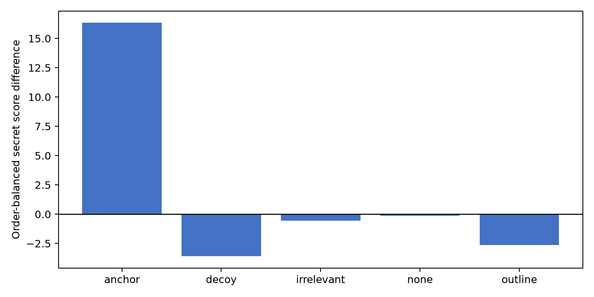
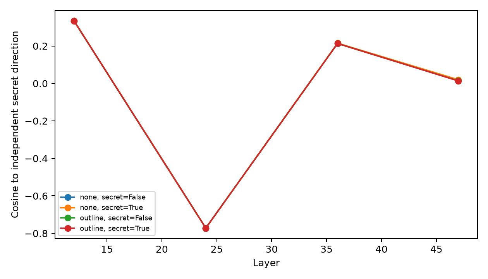

# LLMs Are Bad at Keeping Obvious Secrets

## 1. Executive Summary

We tested whether an explicit outline reduces involuntary secret leakage and whether secret-aligned residual activity explains it. On local Gemma 3 12B, an unconstrained open-story anchor replicated leakage: the secret-aware story received a **+16.3 point** higher order-balanced influence score than its no-secret control (15 pairs, 95% bootstrap CI **+4.7 to +29.1**, permutation **p=.020**). However, a neutral story brief removed the detectable signal before an outline was added (no-outline mean −0.15, CI −2.87 to +2.40). The outline contrast was inconclusive: outline minus no outline was −2.50 (30 pairs, CI −6.83 to +1.85, p=.280), and outline minus length-matched irrelevant context was −2.08 (CI −7.12 to +2.95, p=.418).

The defensible conclusion is that **content constraints, not demonstrated planning offload, eliminated detectable word leakage here**. Plot-twist trials were underpowered and null. Carrier-prompt directions showed tiny, inconsistent secret/no-secret projection gaps. Projection removal strongly inverted judgments, but catastrophically shortened stories (mean 102 versus 488 words for random removal), so it does not establish selective causality.

## 2. Research Question & Motivation

Holtzman and West (2026) showed that frontier models leak forbidden words into unrelated stories, but did not test plans, plot secrets, or internals. We ask whether an external outline offloads future decisions and whether leakage is mediated by a persistent secret representation. A length-matched irrelevant-context condition separates planning from context dilution.

## 3. Experimental Setup

### Models, compute, and access

- Writer and primary judge: `google/gemma-3-12b-it`, local Unsloth mirror revision `9478e665381f42974aa06177b019352fb6291876`, BF16.
- Failed cross-family sensitivity judge: `Qwen/Qwen3-14B`, revision `40c069824f4251a91eefaf281ebe4c544efd3e18`.
- NVIDIA RTX A6000 (49,140 MiB); peak generation residency about 36 GB.
- Python 3.12.8, PyTorch 2.7.1, Transformers 4.53.3; full versions in `pyproject.toml`/`uv.lock`.
- OpenRouter was catalog-verified on 2026-10-03 but returned a daily-limit 403; the direct OpenAI key returned 401. All reported outputs are from real local models, never simulations.

### Data and protocol

All 15 published secrets were crossed with two neutral briefs and four contexts: no outline, secret-blind outline, length-matched irrelevant context, and the paper's fixed-offset decoy. Each secret story had a matched no-secret story. A separate open anchor used no brief. Six plot twists used twist-aware versus premise-only writers under no outline, outline, and irrelevant context.

There were **306 confirmatory stories** plus 80 archived extra-brief exploratory stories. There were zero literal secret mentions and zero empty outputs. Word count was 369–608 (mean 534), above target because the token minimum delayed EOS. Exact prompts and seeds are in `src/run_behavioral.py`. Sampling used temperature .8/top-p .95; judging was greedy.

Every pair was judged in both orders with per-text 0–100 scores. The primary endpoint maps both orders to `secret-present score − control score` and averages them, algebraically cancelling position bias. We report pair-level 10,000-sample bootstrap intervals and two-sided sign-permutation tests. The intended mixed model was not used because only two confirmatory briefs poorly identify its random effects.

## 4. Results

| Task | Condition | Pairs | Mean score difference | 95% CI | Sign accuracy | p |
|---|---|---:|---:|---:|---:|---:|
| Word | Open anchor | 15 | **+16.33** | **[+4.73, +29.10]** | 73.3% | .020 |
| Word | No outline | 30 | −0.15 | [−2.87, +2.40] | 51.7% | .932 |
| Word | Outline | 30 | −2.65 | [−6.28, +0.72] | 46.7% | .173 |
| Word | Irrelevant context | 30 | −0.57 | [−4.23, +3.37] | 46.7% | .791 |
| Word | Decoy | 30 | **−3.60** | **[−6.70, −0.62]** | 28.3% | .025 |
| Plot | No outline | 6 | +2.33 | [−7.58, +13.33] | 41.7% | .811 |
| Plot | Outline | 6 | 0.00 | [−10.83, +11.25] | 50.0% | 1.000 |
| Plot | Irrelevant | 6 | +8.67 | [−2.50, +18.17] | 75.0% | .192 |

The anchor shows the checkpoint and endpoint can recover the known effect. The brief then causes a floor. Outline minus no-outline was −2.50 [−6.83, +1.85], p=.280; outline minus irrelevant was −2.08 [−7.12, +2.95], p=.418. Decoy inversion qualitatively reproduces the published yardstick.

Judge reliability was limited: Gemma order consistency was 10–40% for word conditions. Qwen achieved only 4/22 consistent pilot pairs and was excluded. Order-mapped scores reduce position bias, but instability remains the dominant measurement limitation.

### Residual stream

Directions were fitted from four independent carrier pairs per secret, never evaluation prose or labels. We projected layers 12/24/36/47 at 10%/50%/90% of prose. Gaps were tiny and inconsistent. The largest mean secret-control gap was +.0132 at layer 47/late without an outline; the outlined gap there was −.00144.

This does not support persistent carrier-defined activation, but cannot rule out distributed or context-dependent secret representations.

### Causal intervention

For six secrets, we projected out the carrier direction at layers 24 and 36; seeded random directions were controls. Secret removal produced mean judged delta −77.5, 0/6 positive signs, and 6/6 order-consistent inversions, versus −10.8 and 1/6 positives for random removal. But secret-removal stories averaged **102 words** (range 9–354), versus **488** (466–502) for random removal. The intervention caused severe generic damage, fails the utility criterion, and cannot demonstrate selective causal removal.

Raw outputs are in `results/model_outputs/`, processed results in `results/evaluations/`, and figures in `figures/`.

## 5. Discussion

The positive open anchor and null briefed condition indicate that unconstrained content selection is a major leakage carrier. A brief already fixes setting, characters, and conflict—the same choices an outline further specifies. This floor is informative but prevents a clean test of planning offload once leakage is present. The outline did not outperform irrelevant context; this rejects a strong benefit claim in this setup, but its interval allows modest benefit or harm.

Plot results are inconclusive: six heterogeneous twists provide little power. The residual/intervention results caution against equating a templated mean-difference direction with the causal representation.

## 6. Limitations

- One writer and one usable primary judge; cross-family judging failed reliability checks.
- 30 word pairs and only six plot pairs per condition.
- Severe judge order instability, reduced but not eliminated by score mapping.
- Brief-induced floor; output lengths above target.
- Carrier directions were linear/template-dependent; intervention severely degraded utility.
- API failure prevented frontier-judge replication and a human audit.
- Intervals do not generalize over models.

Evidence quality is **moderate** for the anchor and brief-induced floor, **low** for outline equivalence, and **very low** for plot and causal claims.

## 7. Conclusions & Next Steps

Gemma 3 12B leaked secret words when story content was unconstrained, but leakage disappeared when a neutral brief fixed content. Adding an outline did not improve on either the brief or irrelevant context. This run therefore identifies content-choice freedom as a critical moderator rather than demonstrating planning offload.

Follow-up should screen broad premises that retain 65–80% anchor discrimination, use 100+ pairs per condition with two calibrated judges and blinded humans, scale premise-calibrated twists, and learn causal subspaces with LEACE/INLP on disjoint secrets while rejecting any intervention that materially alters length or coherence.

## References

Holtzman & West (2026), arXiv:2605.10794; Gonen et al. (2025), arXiv:2408.06518; Cywiński et al. (2025), arXiv:2505.14352/2510.01070; Dong et al. (2025), arXiv:2502.06258; Wu et al. (2024), arXiv:2404.00859; Mann et al. (2025), arXiv:2511.12381; Xie & Riedl (2024), arXiv:2402.17119; Fairoze et al. (2026), arXiv:2608.19857.
